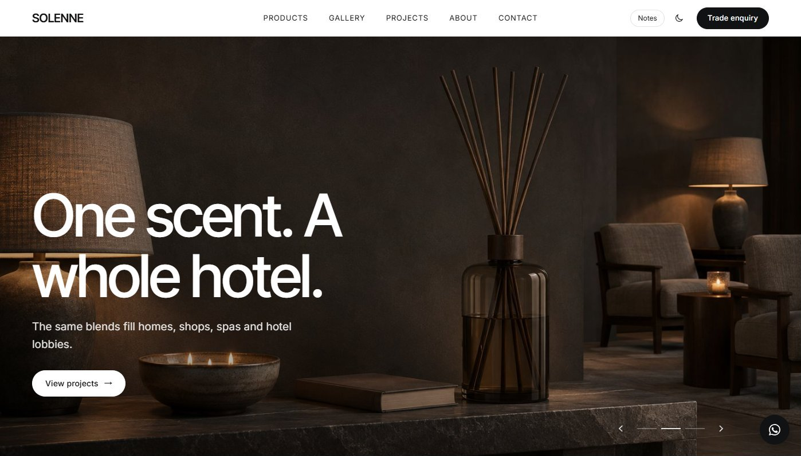
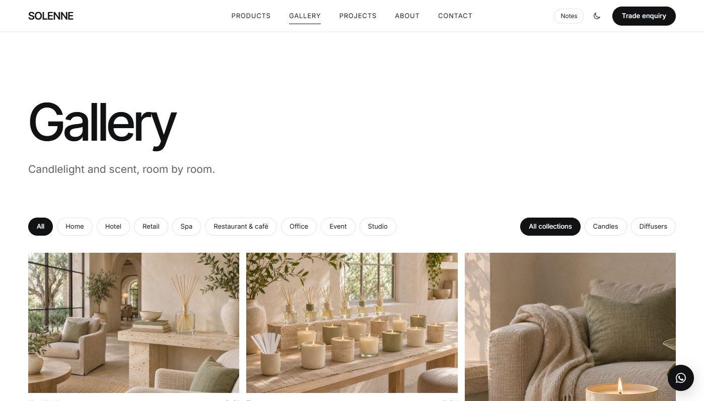

# Modular Showroom

A static website template for **product brands that sell to homes and businesses**: home fragrance, ceramics, lighting, furniture, design objects. 16 pages, data-driven projects and product catalogue, light and dark themes, and a built-in **Notes** mode that explains every section to whoever adapts it.

No framework and no build step. Serve the folder, then edit one config file, two data files and the page copy. The demo brand is a fictional home-fragrance studio, "Solenne".

**Live demo: https://fanzr-arch.github.io/modular-showroom/**




**中文说明见 [README.zh-CN.md](README.zh-CN.md).**

## Pages

| Page | File | What it does |
|---|---|---|
| Home | `index.html` | Full-screen carousel, product tiles, intro, product-line block, materials, scene rail, set cards, ethos, project teaser, catalogue + contact |
| Product line 1 | `candles.html` | Long-form product page with chapter pills and a sticky enquiry button |
| Product line 2 | `diffusers.html` | Shorter page for a second line |
| Objects | `objects.html` | Filterable product grid |
| Catalogue | `scents.html` | Every item with code, size and price, with a format switch |
| Gallery | `gallery.html` | Masonry grid, filters, lightbox |
| Projects | `projects.html` | Filterable project list (type / space / size / collection) |
| Project detail | `project.html?id=P-01` | One template for every project: cover, fact sheet, photo sections, "what's in it", prev / next |
| Enquiry | `quote.html` | Single-column trade / custom enquiry form without site navigation |
| About, Ethos, Making, Principles | `about.html`, `ethos.html`, `manufacturing.html`, `good-design.html` | Brand story pages |
| FAQs | `faqs.html` | Searchable, with FAQPage schema |
| Contact | `contact.html` | Self-serve / direct / form |
| Legal | `legal.html` | Privacy, terms, cookies (sample text) |
| Catalogue (print) | `catalogue.html` | Print source for the catalogue PDF |

Built in: mega menu, mobile menu, dark mode, hero carousel (drag / swipe / keys), card rails, chip filters, lightbox, scroll-spy chapter pills, FAQ search, WhatsApp button, SEO titles and JSON-LD on every page.

## Quick start

```bash
python -m http.server 5330
```

Open http://localhost:5330. Any static host works: GitHub Pages, Cloudflare Pages, Netlify, VS Code Live Server, `npx serve`.

Click **Notes** in the header to see what each section is for and where its content comes from.

## Make it yours

1. **`assets/config.js`**: brand name, wordmark, legal name, email, phone, WhatsApp, location, Instagram, and the Notes toggle (`notes: false` before launch). The header, footer, WhatsApp button and every `data-email` / `data-phone` / `data-wa` link read from here.
2. **Copy**: page text, `<title>`, meta descriptions and JSON-LD sit in each HTML file. Search for `Solenne` to find the brand name.
3. **Look**: colours, fonts and spacing are CSS variables at the top of `assets/site.css`, with the dark-mode set below them.
4. **Navigation**: `SHOP` (mega menu) and `LINKS` at the top of `assets/site.js`. Rename the product pages freely; update the links there.
5. **Projects**: one entry per project in `assets/projects.js`. The list page and the detail page both come from it.
6. **Catalogue**: `assets/parts.js` holds the formats (the switch on the page), table headings, categories and items (code, name, size, notes, picture, optional `price`). The catalogue page and the PDF both read it.
7. **Photos**: the demo photos in `assets/img/photos/` are AI-generated for the fictional brand; each `alt` text describes what the shot should show, so it doubles as a shot list. Put your own images in `assets/img/` and change the `src` (or `photos` / `cover` / `sections` for projects, `PICS` / `img` in the catalogue data). Neutral placeholders are in `assets/img/ph/` if you want to start blank.

### Add a project

```js
project({
  id: 'P-13', title: 'Yoga studio', tagline: 'A calm scent between classes',
  type: 'Wellness', space: 'Studio', size: 'S', system: 'Diffuser', client: 'Yoga studio', site: 'Practice room', area: '80 m²',
  overview: '…', strategy: '…',
  fixtures: [['a', 'Diffuser 500 ml', 'Hinoki Bath']],              // code suffix, name, detail (optional)
  cover: 'projects/yoga-1.jpg', hover: 'projects/yoga-2.jpg',      // optional, relative to assets/img/
  sections: [['projects/yoga-3.jpg', 'projects/yoga-4.jpg']],
}),
```

The `type`, `space`, `size` and `system` values must match the filter buttons in `projects.html`.

### Catalogue PDF

```bash
python tools/build-catalogue.py
```

Prints `catalogue.html` to `assets/catalogue/catalogue.pdf` with headless Edge or Chrome. The site must be served on port 5330 (`--port` to change it).

## Notes

- Fonts load from Google Fonts. Self-host them if you need to work offline.
- Forms (enquiry, contact, newsletter) are front-end only. Connect them to your form service; each form has a comment where the endpoint goes.
- Legal texts are placeholders. Have them reviewed before you publish.
- The demo brand "Solenne", its products, codes, projects and contact details are fictional. The demo photos are AI-generated and released with the template under the same license.

## License

[MIT](LICENSE). Free for personal, client and commercial sites.
