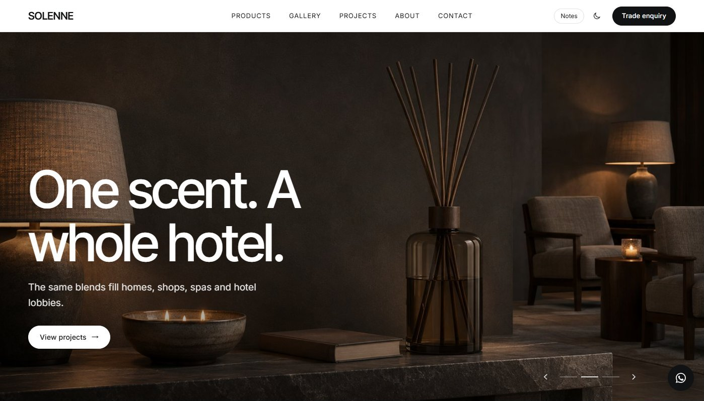
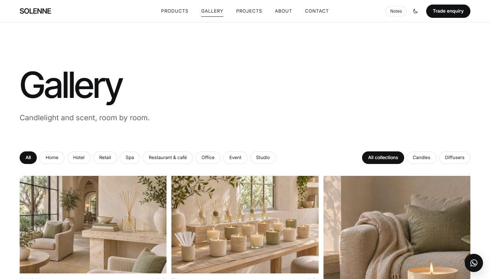

# Modular Showroom

一套给**同时卖给家庭和商家的产品品牌**用的静态官网模板，适合家居香氛、陶瓷、灯具、家具、设计小物等。16 个页面，案例和产品目录由数据生成，支持浅色 / 深色，自带「Notes」标注模式，打开后每个区块都会说明是干什么的。

不用框架，不用构建。用任意静态服务器打开就能跑，改一个配置文件、两个数据文件和页面文案就能换成自己的品牌。演示品牌是一个虚构的家居香氛工作室 "Solenne"。

**在线演示：https://fanzr-arch.github.io/modular-showroom/**




## 页面

| 页面 | 文件 | 内容 |
|---|---|---|
| 首页 | `index.html` | 全屏轮播、产品入口、品牌介绍、产品线、材料、场景横排、套装卡片、理念、案例入口、目录与联系 |
| 产品线 1 | `candles.html` | 长叙事产品页，顶部章节跳转 + 常驻询盘按钮 |
| 产品线 2 | `diffusers.html` | 第二条产品线的简版页面 |
| 小物 | `objects.html` | 可筛选的商品网格 |
| 产品目录 | `scents.html` | 每个单品的编码、规格、价格，可切换形态 |
| 图库 | `gallery.html` | 瀑布流 + 筛选 + 点开大图 |
| 案例列表 | `projects.html` | 按类型 / 空间 / 规模 / 系列筛选 |
| 案例详情 | `project.html?id=P-01` | 一个模板通用：封面、信息表、分区图、用了什么、上一个 / 下一个 |
| 询盘 | `quote.html` | 无导航的单栏表单（批发 / 定制） |
| 关于 / 理念 / 制作 / 原则 | `about.html`、`ethos.html`、`manufacturing.html`、`good-design.html` | 品牌故事页 |
| 常见问题 | `faqs.html` | 可搜索，带 FAQPage 结构化数据 |
| 联系 | `contact.html` | 自助 / 直达 / 表单三级 |
| 法律条款 | `legal.html` | 隐私、条款、Cookie（示例文本） |
| 目录（打印用） | `catalogue.html` | 产品目录 PDF 的排版源文件 |

自带：下拉大菜单、手机菜单、深色模式、首屏轮播（拖动 / 滑动 / 键盘）、横排卡片、筛选、放大看图、章节跳转高亮、FAQ 搜索、WhatsApp 按钮，每页都有 SEO 标题和结构化数据。

## 打开

```bash
python -m http.server 5330
```

访问 http://localhost:5330 。任何静态托管都可以：GitHub Pages、Cloudflare Pages、Netlify、VS Code Live Server、`npx serve`。

点右上角 **Notes**，每个区块会显示说明：这块是干什么的、内容从哪来。

## 换成自己的品牌

1. **`assets/config.js`**：品牌名、Logo 文字、公司全称、邮箱、电话、WhatsApp、地址、Instagram，以及标注开关（上线前改成 `notes: false`）。页头、页脚、WhatsApp 按钮和所有 `data-email` / `data-phone` / `data-wa` 链接都从这里读。
2. **文案**：各页正文、`<title>`、描述和结构化数据在各自的 HTML 里，全局搜索 `Solenne` 替换品牌名。
3. **样式**：颜色、字体、间距是 `assets/site.css` 顶部的 CSS 变量，下面是深色模式那一组。
4. **导航**：`assets/site.js` 顶部的 `SHOP`（下拉菜单）和 `LINKS`。产品页可以随意改名，改完同步这里的链接。
5. **案例**：`assets/projects.js` 里一个案例一条，列表页和详情页都从这里生成。
6. **产品目录**：`assets/parts.js` 里是形态切换、表头、分类和单品（编码、名称、规格、说明、图片、可选 `price`）。目录页和 PDF 读的是同一份。
7. **照片**：`assets/img/photos/` 里的演示照片是给虚构品牌用 AI 生成的；每张图的 `alt` 写着这里该拍什么，可以直接当拍摄清单。把自己的图放进 `assets/img/`，改 `src` 就行（案例改 `photos` / `cover` / `sections`，目录改 `PICS` / `img`）。想从空白开始，`assets/img/ph/` 里有中性占位图。

### 加一个案例

在 `assets/projects.js` 里照现有格式加一条（见英文 README 的示例）。`type`、`space`、`size`、`system` 的值要和 `projects.html` 里的筛选按钮对得上。

### 目录 PDF

```bash
python tools/build-catalogue.py
```

用无头 Edge / Chrome 把 `catalogue.html` 打印成 `assets/catalogue/catalogue.pdf`。网站要开在 5330 端口（可用 `--port` 改）。

## 说明

- 字体来自 Google Fonts，需要联网；要离线用就改成本地字体文件。
- 表单（询盘、联系、订阅）只有前端，需要接自己的表单服务，每个表单里有注释标出填地址的位置。
- 法律条款是示例文本，上线前请找律师审阅。
- 演示品牌 "Solenne" 以及其中的产品、编码、案例和联系方式都是虚构的；演示照片由 AI 生成，随模板按同一许可证开放。

## 许可

[MIT](LICENSE)，个人、客户项目、商业网站都可以免费用。
